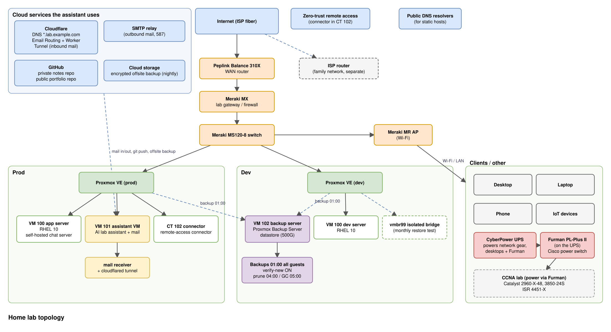

# Austyn Browning's Home Lab

Hands-on notes from my home lab: virtualization, Linux servers, networking, and automation, built while I study for the **Cisco CCNA (200-301)**.

## Lab at a glance
- **Virtualization:** two Proxmox VE 9 nodes (a prod Xeon node and a dev node), RHEL 10 guests
- **Network:** Peplink Balance (WAN), Cisco Meraki MX firewall, MS switch and MR access point
- **CCNA rack:** Cisco Catalyst 2960-X (PoE+), Catalyst 3850-24S (L3, fiber), ISR 4451-X router
- **Remote access:** Twingate zero-trust connector, Cloudflare Tunnel
- **Automation:** an always-on AI assistant VM that helps run and document the lab

## Topology

## Projects
| Project | Skills |
|---|---|
| [Self-hosted E2E chat server on RHEL 10](projects/suttonchat-server.md) | RHEL, SELinux, firewalld, PostgreSQL, Valkey, Cloudflare Tunnel |
| [Least-privilege Proxmox API access](projects/proxmox-least-privilege.md) | Proxmox VE, RBAC, API tokens, SSH keys, dev/prod separation |
| [GNOME black screen after a partial RHEL update](projects/rhel-gnome-black-screen.md) | Linux troubleshooting, dnf, GSettings schemas |
| [Nightly LAN device monitoring](projects/lan-watch.md) | Bash, ARP, OUI lookup, cron, alerting |
| [Chess game analysis pipeline](chess/analysis-pipeline.md) | Python, REST APIs, Stockfish/UCI, data analysis |

## CCNA
- [Study plan](ccna/study-plan.md) and [labs](ccna/labs/) on real Cisco hardware

